

# Mac-style Language Popup

**The Windows 11 input language switcher, right where you type.**

A [Windhawk](https://windhawk.net) mod. When you change the keyboard language, a small panel shows up next to the text cursor instead of in the corner of the screen, the way it works on macOS.

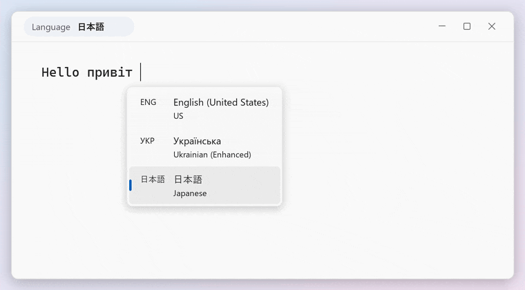

Alt+Shift through English → Ukrainian → Japanese → English while typing (illustration, drawn from the mod's own layout rules; visible time set to 1.5 s here and <i>Language names in their own language</i> on). The panel hides on the first keystroke.

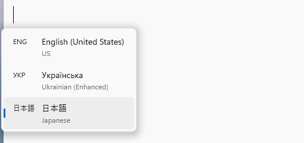 The real thing: a screenshot of the mod in Notepad on Windows 11.

## Why

On Windows the language indicator lives in the bottom-right corner of the taskbar. When you press Alt+Shift you have to look away from the text to check which language you got, or type a few letters and see. This mod puts the answer where your eyes already are:

- **At the text cursor.** The panel opens right under the blinking cursor in most apps: Notepad, web browsers, Electron apps, Telegram, Zed, the Settings app (see [Where it works](#where-it-works)).
- **Out of the way.** It hides about a third of a second after you let go of the keys, or as soon as you start typing.
- **One panel only.** Windows' own Win+Space switcher is hidden by default and this panel follows it, so you never see two lists.
- **Looks like Windows 11.** Rounded corners, a soft shadow, your accent color, light and dark theme.
- **Your way.** List or a single entry, vertical or horizontal, full names or just ENG / УКР / 日本語, placement, size, timing and animation are all settings.

## Styles

Pick the full list or only the language you switched to (the macOS way), and how much text each entry shows.

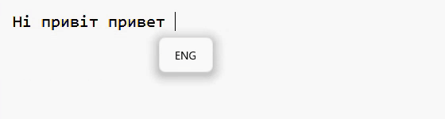

"Show only the new language" plus codes only: a tiny box like on a Mac (illustration).

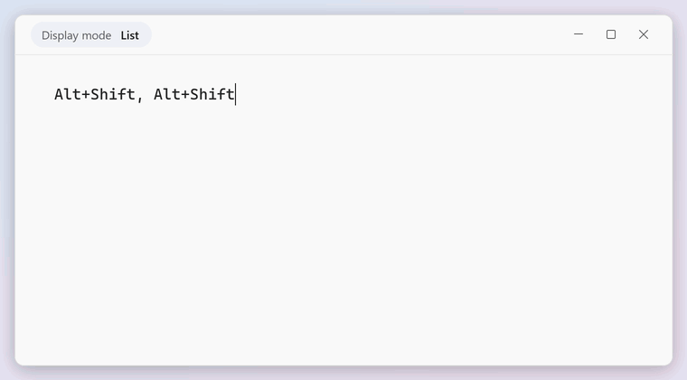

Every display mode, two switches each (illustration). Set them with <i>List direction</i>, <i>Show only the new language</i>, <i>Reverse language order</i> and the <i>What each entry shows</i> settings.

Below: every style in light and dark theme (illustration).

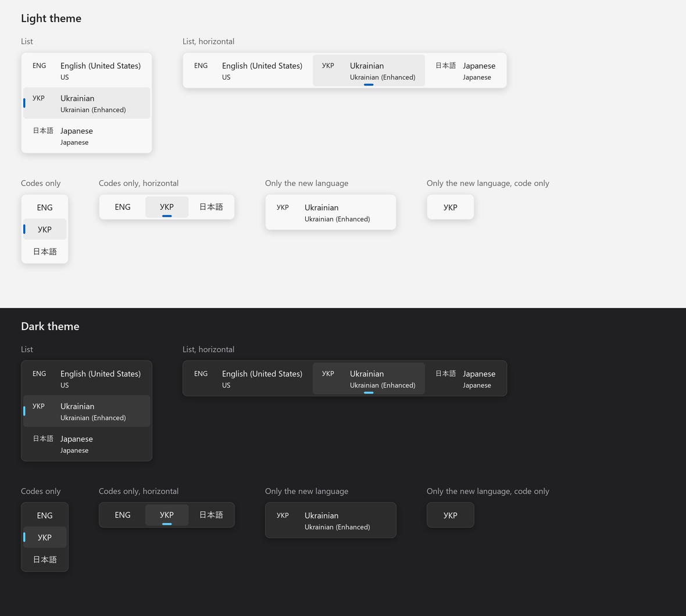

## Install

The mod is not in the Windhawk catalog yet, so it is installed as a local mod. It takes about a minute.

1. Install [Windhawk](https://windhawk.net) (version 1.7.3 or newer) and open it.
2. On Windhawk's home page click **Create a New Mod**. An editor opens with sample code.
3. Open [`mods/mac-style-language-popup.wh.cpp`](mods/mac-style-language-popup.wh.cpp) on GitHub (<https://github.com/Gasased/windhawk-language-selector>) and click the **Copy raw file** button (top right of the file view). Back in Windhawk, select everything in the editor (Ctrl+A) and paste (Ctrl+V).
4. Click **Compile Mod**, then **Exit Editing Mode**.

The mod starts right away, no restart or sign-out needed. Open it in Windhawk and go to the **Settings** tab to change how it looks and behaves. To remove it, disable or delete it on the same page.

## Using it

Nothing to learn. Switch languages the way you already do:

| You press | What you see |
|---|---|
| Your language hotkey, **Alt+Shift** or **Ctrl+Shift** (a quick tap) | The panel appears at the cursor with the new language highlighted, then hides. |
| Your language hotkey **held** for a moment | A preview of the language you are about to switch to. Release to switch. |
| **Shift held, Alt tapped** several times (or the other way round) | The panel stays open while you step through the languages and hides after you let go. |
| **Win+Space** | Windows' own switcher stays hidden; this panel shows its selection as you press Space (with the default *Hide it*; see [When there is no text cursor](#when-there-is-no-text-cursor) for windows without a cursor). |
| Any other shortcut or tool that switches the language while you stay in the app | The panel appears at the cursor a moment after the switch. |

Click a language in the panel to switch to it (not available with *Show only the new language*). Hover over the panel to keep it open; with the default short visible time, move the pointer onto it quickly or raise *Time visible after the keys are released*.

Picking a language from the taskbar's language indicator moves focus to the taskbar, so the panel doesn't appear for that.

The mod reads the language hotkey you chose in Windows (Settings → Time & language → Typing → Advanced keyboard settings → Input language hot keys). If that hotkey is Alt+Shift or Ctrl+Shift, and *Windows' own language switcher* is set to *Hide it* (the default), the panel appears the instant you release the keys and holding them shows the preview. In every other case (a different hotkey, a separate layout-switching hotkey, other tools, or the other switcher modes) the panel appears as soon as Windows reports the change, a fraction of a second later.

## Settings

All settings are in the mod's **Settings** tab in Windhawk and apply immediately. Sizes in pixels mean pixels at 100% display scaling; they grow with your Windows scaling setting. Everything drawn inside the panel (corner radius, padding, spacing) also grows with *Size (%)*; offsets and slide distance do not.

The animations below are redrawn illustrations of what each group of settings does, built from the same sizes and rules the mod uses.

### Behavior

| Setting | Default | What it does |
|---|---|---|
| Windows' own language switcher | Hide it | What to do with the switcher Windows shows for Win+Space or holding Alt and pressing Shift. **Hide it**: this panel shows its selection instead (recommended). **Show it too, moved next to the text cursor**: Windows' switcher is moved to the cursor (if there is no cursor it stays in its usual place, or goes to the mouse pointer when that no-cursor setting is on), and this panel appears only for switches without Windows' switcher, such as a quick Alt+Shift. **Show it too, where Windows puts it**: Windows' switcher is left alone, and this panel appears for the same quick switches. The instant panel and the hold preview need **Hide it**. |
| Show only the new language (like macOS) | Off | Off: the whole list with the new language highlighted. On: one entry with just the new language. |
| Hide as soon as you start typing | On | Any key other than Shift, Ctrl, Alt or Win closes the panel. |
| Click a language to switch to it | On | Clicking an entry switches to that language. Doesn't work with *Show only the new language*. |

The panel also stays open while you hold a key of your language hotkey (Shift, Alt or Ctrl). With *Hide as soon as you start typing* off, that includes holding Shift to type capitals.

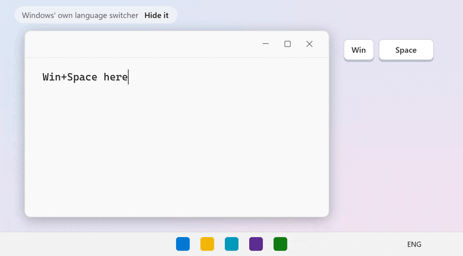 <i>Windows' own language switcher</i> (Win+Space in a text field), then the two no-cursor options on the desktop. Tags mark which panel is Windows' and which is this mod's.

*Hide as soon as you start typing* and *Click a language to switch to it* are shown in the animation under [Timing and animation](#timing-and-animation).

### When there is no text cursor

Games, full-screen apps, the desktop and windows without a text field have no cursor to point at.

| Setting | Default | What it does |
|---|---|---|
| If there's no text cursor, keep Windows' usual behavior | On | Only matters when *Windows' own language switcher* is *Hide it*. On: Windows' own switcher appears in its usual place for Win+Space or Alt held + Shift, and a quick Alt+Shift shows nothing. Off: nothing is shown at all, so Win+Space gives no visual feedback on the desktop or in apps without a cursor. |
| If there's no text cursor, show this panel at the mouse pointer | Off | The panel opens at the mouse pointer instead. Takes priority over the setting above. |

### Finding the text cursor

| Setting | Default | What it does |
|---|---|---|
| Use UI Automation to find the text cursor | On | Needed for modern apps (Settings, Microsoft Store apps, WinUI, WPF). It can make Chromium-based apps turn on their accessibility support, which costs a little memory; turn it off if you don't need it. |
| Remember the text cursor position in each window | Off | For apps that hide their cursor right after you switch to them until you click or type, such as Telegram and other apps built with Qt. The panel goes where the cursor last was in that window, as long as the window hasn't moved or been resized. |

### Placement

| Setting | Default | What it does |
|---|---|---|
| Placement relative to the text cursor | Below | Below, above, right or left of the cursor. Flips to the other side automatically when there is no room on screen. |
| Horizontal offset (px) | 0 | Below or above: shifts the panel sideways (negative = left). Right or left: extra distance from the cursor. |
| Vertical offset (px) | 4 | Below or above: extra distance from the cursor. Right or left: shifts the panel up or down. |

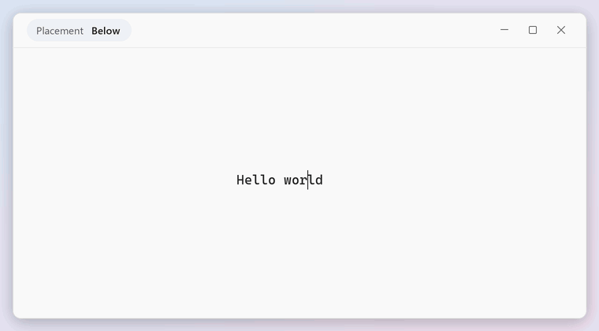 Each placement, <i>Vertical offset</i> growing the gap to the cursor, and the automatic flip when there is no room (entries shown on one line here).

### Timing and animation

| Setting | Default | What it does |
|---|---|---|
| Delay before appearing (ms) | 0 | Waits this long before showing the panel, for switches the mod notices from the language change itself. The instant panel for your language hotkey and the Win+Space panel are not delayed. |
| Time visible after the keys are released (ms) | 300 | About how long the panel stays after you let go of the keys. For switches not made with the keyboard it counts from when the panel appears. Hovering it keeps it open. |
| Animation | Fade and slide | Fade and slide, fade and zoom, fade, or none. |
| Appear animation duration (ms) | 140 | Length of the appear animation (fade plus slide or zoom). |
| Disappear animation duration (ms) | 220 | Length of the disappear animation. |
| Slide distance (px) | 8 | How far the panel slides in. |

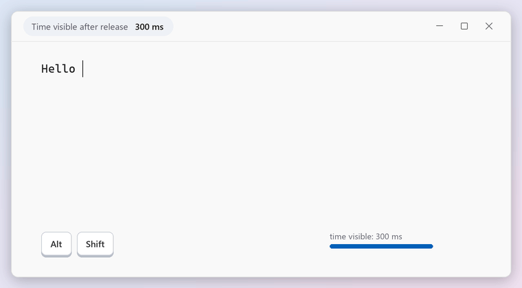 <i>Time visible after the keys are released</i>, <i>Hide as soon as you start typing</i> and <i>Click a language to switch to it</i>. The timer bar next to the keys is only for illustration.

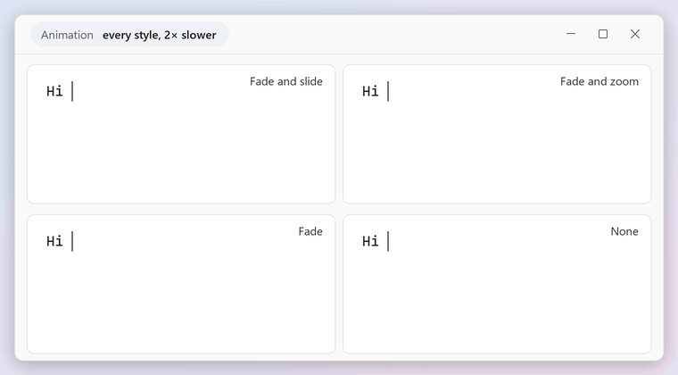 The four <i>Animation</i> styles, slowed down 2× and with the slide distance doubled so the motion is easy to see.

### Look

| Setting | Default | What it does |
|---|---|---|
| List direction | Vertical | Vertical list or a horizontal row. List mode only. |
| Reverse language order | Off | Languages are listed in the order of your Windows language list; this flips it. List mode only. |
| Size (%) | 100 | 50 to 400. |
| Opacity (%) | 97 | Opacity of the panel background, 10 to 100. Text stays fully opaque. |
| Corner radius (px) | 8 | 0 gives square corners. |
| Drop shadow | On | A soft shadow around the panel. |
| Theme | Follow Windows | Follow Windows, dark or light. |
| Accent color | empty | Color of the selection mark (list mode only), written exactly as `#RRGGBB` (for example `#FF8800`). Empty, or anything not in exactly that form, uses your Windows accent color. |
| Font | Segoe UI Variable Text | Any installed font name. |

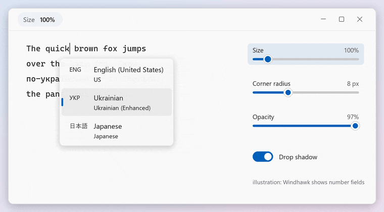 <i>Size</i>, <i>Corner radius</i>, <i>Opacity</i> (text behind shows through) and <i>Drop shadow</i>.

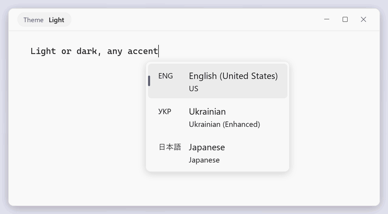 <i>Theme</i> and <i>Accent color</i> (shown at 125% size).

### What each entry shows

| Setting | Default | What it does |
|---|---|---|
| Show language code (ENG, УКР) | On | The three-letter code, the same one the taskbar shows. |
| Show language name (English (United States)) | On | Turn off the name and the layout to get compact boxes with only the code. |
| Show keyboard layout (US) | On | The layout name under the language name. |
| Language names in their own language | Off | Shows each name in its own language, for example Українська instead of Ukrainian. |

If all three parts are turned off, the code is shown anyway.

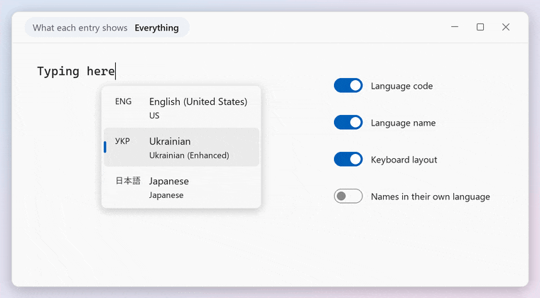 Turning the parts of each entry on and off, down to compact codes only.

### Spacing

| Setting | Default | What it does |
|---|---|---|
| Panel padding (px) | 4 | Space between the panel edge and the language boxes. |
| Box padding, left and right (px) | 16 | Space inside each language box, left and right. |
| Box padding, top and bottom (px) | 8 | Space inside each language box, above and below the text. |
| Gap between the code and the name (px) | 12 | |
| Space between language boxes (px) | 2 | |

Spacing values are limited to 0–64. They are drawn inside the panel, so they also grow with *Size (%)*.

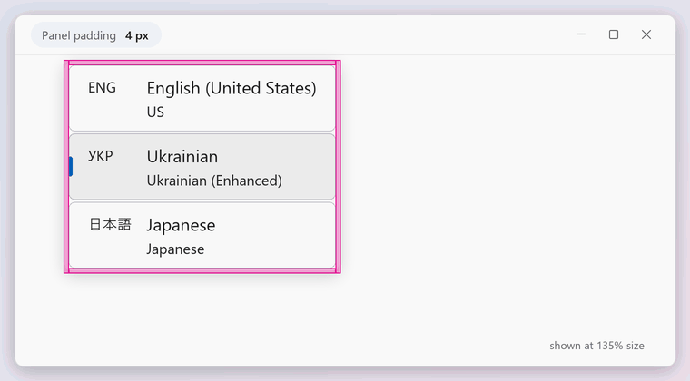 Each spacing setting, highlighted while it changes (shown at 135% size).

## Where it works

The mod looks for the text cursor in several ways, one after another, so it covers almost every kind of app.

| App | How the cursor is found | Tested |
|---|---|---|
| Classic Windows apps (Notepad, WordPad-style editors, dialogs) | Standard Windows caret | Notepad |
| Chrome, Edge, Firefox, Electron apps (VS Code, Discord, Slack…) | Accessibility caret | Edge web pages and address bar |
| Settings, Microsoft Store apps, WinUI and WPF apps | UI Automation | Settings search box |
| Telegram and other Qt apps | Standard Windows caret (plus the *remember* setting right after Alt+Tab) | Telegram |
| Zed | Reads the position Zed reports to the keyboard input system; the mod is loaded into `Zed.exe` for this | Zed |

Some apps draw their own cursor and report it nowhere Windows can see. If such an app reports its cursor position to the input system the way Zed does, you can add it yourself: open the mod in Windhawk, go to the **Advanced** tab and add the app's file name (for example `wezterm-gui.exe`) to the process inclusion list. Whether a particular app works this way has to be tried.

## Requirements

- **Windows 11.** Developed and tested on builds 26200 (25H2) and 26300 (Insider). Older Windows 11 versions (22H2, 23H2, 24H2) have not been tested. Windows 10 is not supported: it is untested, and the default font (Segoe UI Variable) doesn't exist there, so text falls back to another font. Hiding Windows' own Win+Space switcher relies on how Windows positions it; if on your system it still shows up in the corner next to this panel, set *Windows' own language switcher* to *Show it too, where Windows puts it*.
- **Windhawk 1.7.3 or newer.**
- Tested with English, Ukrainian, Russian and Japanese (Microsoft IME) as three-language sets, at 100% and 150% display scaling, on a single monitor. Multi-monitor setups should work (the panel follows the scaling of the monitor the cursor is on) but have not been tested.

## Troubleshooting

**The panel doesn't appear in some app.** That app doesn't expose its text cursor, so the mod falls back to Windows' usual behavior. Turn on *If there's no text cursor, show this panel at the mouse pointer* to always get the panel. If the app hides its cursor only right after you switch to it, try *Remember the text cursor position in each window*.

**I want Windows' own switcher back.** Set *Windows' own language switcher* to *Show it too, where Windows puts it*.

**The panel covers what I'm typing.** Change *Placement relative to the text cursor* or increase *Vertical offset*.

**It disappears too fast / stays too long.** Change *Time visible after the keys are released*. Turn off *Hide as soon as you start typing* if you want it to stay for the full time.

## Known limitations

- After a page navigation, Chromium-based browsers sometimes report the old cursor position for a moment, so the panel can open where the cursor used to be.
- Apps running as administrator may not let the mod read their cursor, and then you get the no-cursor behavior. This has not been tested.
- Games and full-screen apps get no special handling; they usually have no text cursor, so the no-cursor settings apply.

## How it works

The mod runs inside Windows Explorer. It notices a language change by watching the keyboard layout of the focused window (and the Alt+Shift / Ctrl+Shift keys themselves, so it can react before the app catches up), finds the text cursor, and draws its own small window there with Direct2D. Windows' own switcher is moved off screen when hidden; the mod reads its selection through UI Automation so the panel can mirror it. In Zed it additionally hooks the two functions Zed uses to tell the input system where the cursor is.

It does not use the network and never records or sends what you type. To spot the language hotkey and the start of typing, it checks which keys are down (not what they type) about 20 times a second, and 100 times a second while the language hotkey is held.

## License

[MIT](LICENSE)
